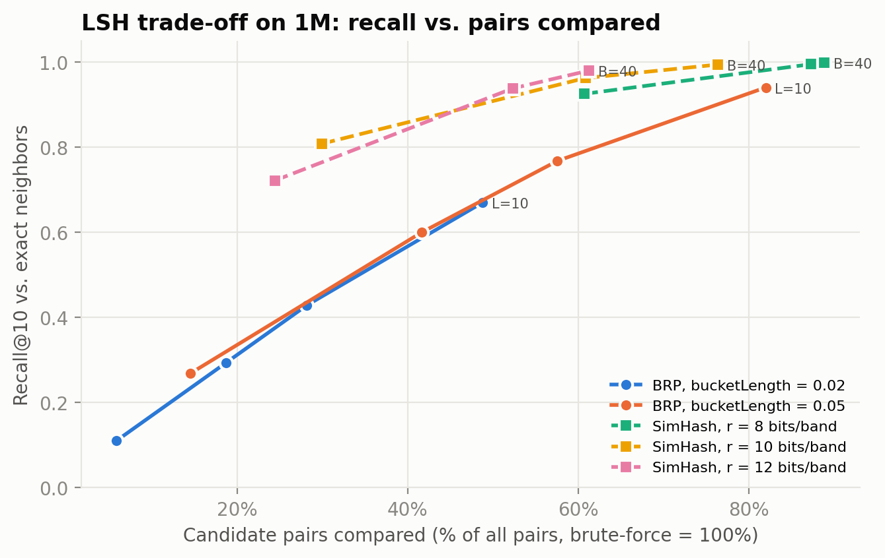
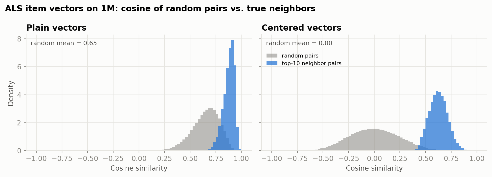
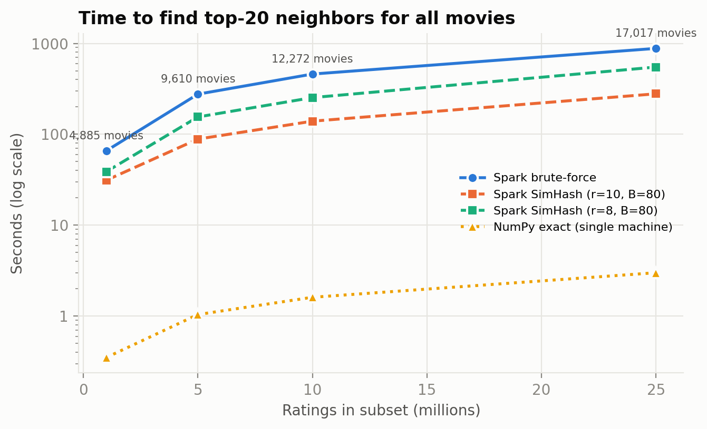

# CO5135 Big Data: Large-scale Recommender System with LSH

Mini-project for CO5135 Big Data (HCMUT, Semester 1, 2026-2027).
Student: Pham Thi Thai Minh (2570757).

## Problem

Item-based collaborative filtering needs the nearest neighbors of every item.
Brute-force search compares all n(n-1) pairs of items and does not scale as data grows.
This project uses Locality Sensitive Hashing (LSH) in Spark to find similar items
approximately, and compares accuracy and runtime against brute-force on MovieLens 25M.

## Method

1. **ALS** (Spark MLlib) learns latent vectors for items (rank 40, regParam 0.1, 10 iterations,
   tuned on a validation split of the 1M subset).
2. **Item vectors:** only movies with at least 20 ratings in train are searched
   (58.8% of all movies have fewer than 10 ratings, their vectors are unreliable).
   Vectors are **mean-centered** (the mean item vector is subtracted) and L2-normalized,
   so the similarity is the cosine of centered vectors.
3. **Exact top-20 neighbors:** NumPy on one machine (reference) and Spark brute-force (cross join of all pairs).
4. **LSH**, two variants:
   - Spark built-in `BucketedRandomProjectionLSH` (BRP): one random projection per hash table,
     tables combined with OR only.
   - **SimHash banding** (implemented with Spark DataFrame joins): random hyperplanes,
     r bits per band (AND) and b bands (OR), the S-curve construction from the LSH lecture.
5. **Evaluation:** test RMSE (ALS); Recall@10 of LSH neighbors vs exact neighbors;
   candidate pairs compared (% of all pairs); runtime; Precision@10 of item-based
   recommendation (score = sum of similarities to movies the user rated >= 4) vs a popularity baseline.

## Dataset

MovieLens 25M (https://grouplens.org/datasets/movielens/25m/).
Data is downloaded automatically in `00-prepare-data` and is not stored in this repo.

| Subset | Ratings | Users | Movies | Sparsity |
|---|---|---|---|---|
| 1M | 999,935 | 6,580 | 19,991 | 99.24% |
| 5M | 4,999,764 | 32,665 | 35,730 | 99.57% |
| 10M | 9,999,663 | 65,080 | 45,417 | 99.66% |
| 25M | 25,000,095 | 162,541 | 59,047 | 99.74% |

Subsets are sampled by user (seed 42) and nested (1M in 5M in 10M in 25M).
Train/test split: 80/20 (seed 42).
Long tail: the top 1% of movies receive 47.6% of all ratings.

## Environment

- Kaggle Notebooks, CPU, 4 cores, about 30 GB RAM
- PySpark 4.0.4 (`local[*]`, driver memory 20g)
- Runtimes are from one run per configuration; Spark times vary by about 10 to 40% between runs.

## Notebooks

| Notebook | Content |
|---|---|
| `00-prepare-data.ipynb` | Download data, CSV to Parquet, create subsets, train/test split |
| `01-eda.ipynb` | Rating distribution, long-tail analysis |
| `02-als-bf-lsh.ipynb` | ALS tuning, brute-force kNN, LSH (Spark BRP and SimHash banding) on the 1M subset |
| `03-scalability.ipynb` | Centering test on 1M, then brute-force vs SimHash from 1M to 25M |
| `04-seminar-demo.ipynb` | Seminar demo: MinHash, banding S-curve, random hyperplanes, Euclidean LSH |

## How to run

1. Open a notebook on Kaggle, set Accelerator = None and Internet = On.
2. Run `00-prepare-data` first (Save Version), then add its output as Input to the other notebooks.
3. Run All (or Save Version > Save & Run All for the long notebooks 02 and 03).

## Results

### 1. ALS and LSH variants on the 1M subset (4,885 movies, 23.9M pairs, plain vectors)

ALS (rank 40, regParam 0.1): test RMSE 0.8237.

| Method | Pairs compared | Time | Recall@10 | Precision@10 |
|---|---|---|---|---|
| NumPy exact (single machine) | 100% | 0.34 s | 1.000 | 0.084 |
| Spark brute-force | 100% | 82.7 s | 1.000 | 0.084 |
| Spark BRP, bucketLength 0.05, 10 tables | 82% | 511 s | 0.940 | 0.083 |
| SimHash banding, r = 12, b = 20 | 52% | 50.6 s | 0.938 | 0.083 |
| Popularity baseline | | | | 0.120 |

Spark BRP (OR only) is about 6x slower than brute-force at the same recall.
SimHash banding (AND + OR) is 1.6x faster. LSH neighbors give the same Precision@10 as exact neighbors.

### 2. Mean-centering the item vectors (1M)

| | Plain | Centered |
|---|---|---|
| Mean cosine of random movie pairs | 0.65 | 0.00 |
| Fewest pairs for Recall@10 >= 0.9 | 39.3% (r = 16, b = 80) | **15.0% (r = 10, b = 80)** |
| Precision@10 (exact neighbors) | 0.084 | **0.121** |

ALS item vectors share a large common direction (norm of the mean vector = 0.8 of the mean norm),
so unrelated movies have high cosine and collide in LSH buckets. Centering removes it:
fewer candidate pairs at the same recall, and better recommendations (now above the popularity baseline).

### 3. Scalability (centered vectors, SimHash r = 10, b = 80)

| Subset | Movies used | Pairs | NumPy | Spark brute-force | SimHash | Pairs compared | Recall@10 | Speedup |
|---|---|---|---|---|---|---|---|---|
| 1M | 4,885 | 23.9M | 0.35 s | 65.8 s | 31.2 s | 15.0% | 0.908 | 2.1x |
| 5M | 9,610 | 92.3M | 1.04 s | 276.5 s | 88.6 s | 18.4% | 0.983 | 3.1x |
| 10M | 12,272 | 150.6M | 1.61 s | 460.0 s | 139.4 s | 19.2% | 0.992 | 3.3x |
| 25M | 17,017 | 289.6M | 3.00 s | 881.4 s | 279.0 s | 19.9% | 0.997 | 3.2x |

Notes:

- Spark brute-force time grows with the number of pairs (n²); SimHash compares only 15 to 20% of them
  and is about 3x faster from 5M upward, with recall rising to 0.997.
- NumPy on one machine is still the fastest here: 17,017 movies fit in memory. The benefit of LSH is measured
  inside the same distributed engine; it becomes necessary when the number of items reaches hundreds of
  thousands to millions, where n² pairs cannot be compared on one machine.
